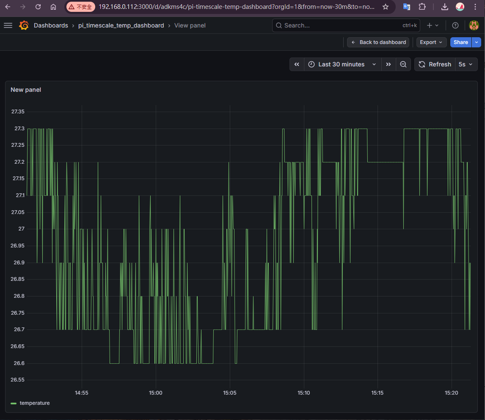
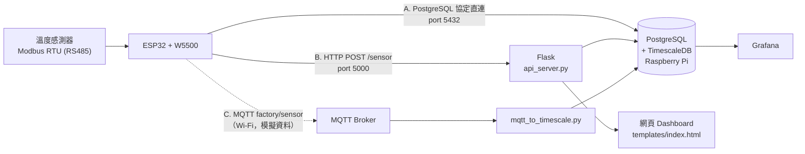

# ESP32 Modbus 溫度資料收集系統（TimescaleDB）

ESP32 透過 RS485（Modbus RTU）讀取溫度感測器，把資料寫入 Raspberry Pi 上的 PostgreSQL / TimescaleDB，再用 Grafana 或自製網頁畫出即時曲線。

依不同需求，實作並比較了三種資料上傳方式：**ESP32 直接連資料庫**、**HTTP API**、**MQTT**。



## 系統架構



## 為什麼選 TimescaleDB

感測資料每 2 秒寫一筆，時間一長資料量會很大，一般的 PostgreSQL 資料表會越來越肥、查詢越來越慢。TimescaleDB 是 PostgreSQL 的擴充套件，原本的 SQL 可以照用，另外多了兩個功能：

- **Hypertable**：依時間自動分區，寫入和「查最近 N 分鐘」這類查詢比較快
- **壓縮**：舊資料可以自動壓縮，減少硬碟空間（設定在 `sql/schema.sql`）

## 技術重點

- **ESP32 不透過中介程式，直接實作 PostgreSQL 通訊協定**（Startup、MD5 認證、Simple Query），用 W5500 有線網路把資料寫進資料庫
- MD5 認證用 ESP32 內建的 `mbedtls` 計算雜湊
- Modbus RTU：9600 bps 8N1，讀取 Holding Register 43，數值除以 10 轉成溫度
- 斷線時會自動重新連線

## 硬體與軟體

| 類別 | 項目 |
| --- | --- |
| 微控制器 | ESP32-S3 + W5500 乙太網路 |
| 感測器 | SM02（RS485 / Modbus RTU） |
| 伺服器 | Raspberry Pi 4 |
| 資料庫 | PostgreSQL-17 + TimescaleDB、pgAdmin |
| 視覺化 | Grafana、Flask + Chart.js 網頁 |
| Arduino 函式庫 | Ethernet2、ModbusMaster、PubSubClient |

## 檔案說明

| 路徑 | 方式 | 說明 |
| --- | --- | --- |
| `ESP32_TimescaleDB/` | A | 第一版直連（資料庫在電腦上），trust 模式（不需密碼），呼叫 `insert_machine_data_json()` 函式寫入 |
| `ESP32_pi_TimescaleDB/` | A | 改連 Raspberry Pi 上的 `iot_db`，trust 模式 |
| `ESP32_pi_GUI_TimescaleDB/` | A | 加入 MD5 密碼認證，可搭配 pgAdmin 使用 |
| `ESP32_pi_TimescaleDB_Dashboard/` | A | 同上，多寫入濕度欄位（目前是測試用固定值） |
| `ESP32_W5500HTTP/` | B | ESP32 用 HTTP POST 把 JSON 送到 Flask |
| `api_server.py`、`templates/` | B | Flask API：接收資料寫入資料庫，並提供即時溫度網頁 |
| `mqtt_to_timescale/` | C | ESP32 透過 Wi-Fi 發布 MQTT（目前是隨機模擬溫度） |
| `mqtt_to_timescale.py` | C | 訂閱 MQTT 並寫入資料庫 |
| `sql/schema.sql` | — | 建立資料表、hypertable 與壓縮策略 |

## 如何執行

1. **資料庫**：在 Raspberry Pi 安裝 PostgreSQL 和 TimescaleDB，然後執行 `sql/schema.sql`
2. **ESP32**：用 Arduino IDE 開啟其中一個資料夾，把 `dbServer` IP、`DB_NAME`、`DB_PASS` 改成自己的環境後燒錄
3. **Python（方式 B / C）**：
   ```bash
   pip install -r requirements.txt
   export PG_PASSWORD=你的密碼
   python3 api_server.py          # 方式 B，網頁在 http://<IP>:5000
   python3 mqtt_to_timescale.py   # 方式 C
   ```
4. **Grafana**：新增 PostgreSQL 資料來源，查詢 `sensor_data` 資料表

> 注意：ESP32 直連版本只支援 **trust** 和 **MD5** 認證。PostgreSQL 14 以後預設使用 `scram-sha-256`，需要在 `pg_hba.conf` 把 ESP32 的 IP 設成 `md5`。

## 三種方式比較

| 項目 | A. 直連資料庫 | B. HTTP API | C. MQTT |
| --- | --- | --- | --- |
| 架構 | ESP32 → DB | ESP32 → Flask → DB | ESP32 → Broker → Python → DB |
| 中介程式 | 不需要 | Flask | MQTT Broker + Python 訂閱程式 |
| 帳密安全性 | 較差（資料庫帳密存在 ESP32） | 較好 | 較好 |
| 即時推播 | 不適合 | 需額外機制 | 適合 |
| 多設備擴充 | 還行 | 良好 | 很好 |

## 詳細教學（部落格）

- [Raspberry Pi 做 PostgreSQL(Timescale) 讓真實溫度資料寫入到PostgreSQL - 繪製曲線圖](https://asps5414.blogspot.com/2026/03/raspberry-pi-postgresqltimescale_30.html)
- [Raspberry Pi 做 PostgreSQL(Timescale) 讓真實溫度資料寫入到PostgreSQL - PostgreSQL有GUI操作畫面](https://asps5414.blogspot.com/2026/04/raspberry-pi-postgresqltimescale.html)
